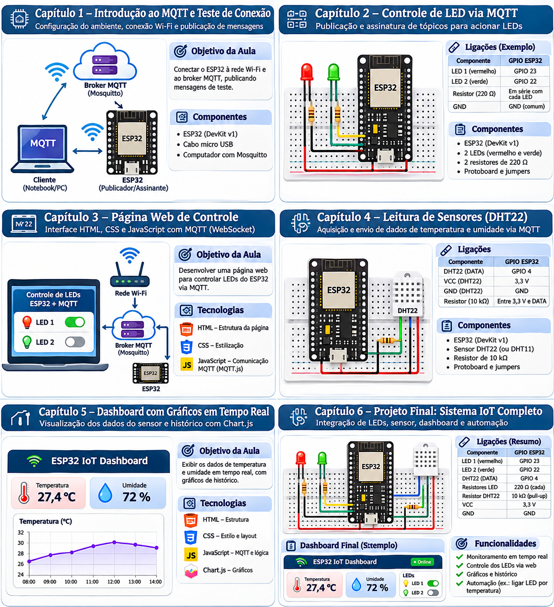

## 📱 Dashboard para alunos — GitHub Pages

O mesmo repositório publica automaticamente `projeto-final/web/` no GitHub Pages.
**Endereço depois da publicação:** `https://SEU-USUARIO.github.io/ifpa-esp32-mqtt-iot/` (substitua `SEU-USUARIO`).

**[Guia de publicação e QR Code](docs/publicacao-github-pages.md)** · [Dashboard (fontes)](projeto-final/web/)

> A publicação depende de criar o repositório na sua conta e ativar **Settings → Pages → Source: GitHub Actions**. O ZIP não publica o site por si só.

# Internet das Coisas na Prática — ESP32, MQTT e Dashboard Web

**Instituto Federal do Pará — Campus Bragança**  
**Curso Técnico em Informática**  
**Professor:** Marcus Vinicius Brito  
**Carga horária:** 6 aulas de 100 minutos (10 horas)



Repositório didático com apostilas para estudantes e professor, diagramas por aula, exemplos incrementais e aplicação final de monitoramento e automação com **ESP32 + DHT22 + Mosquitto + MQTT.js + Chart.js**.

> **Estado:** material didático organizado e verificado estruturalmente. A compilação na placa e os testes elétricos precisam ser realizados no laboratório antes da aplicação.

## Comece aqui

1. Consulte [pré-requisitos e montagem](docs/montagem.md).
2. Prepare o [broker Mosquitto](infra/mosquitto/README.md).
3. Siga as [aulas 1 a 6](aulas/README.md), em ordem.
4. Para executar o sistema completo, siga [projeto final](projeto-final/README.md).
5. Use o [roteiro de testes](docs/testes.md) e a [rubrica](docs/avaliacao.md).

## Estrutura

```text
.
├── README.md                 # apresentação e início rápido
├── aulas/                    # aulas 01 a 06 e fontes incrementais
├── projeto-final/            # firmware e dashboard integrados
├── infra/mosquitto/          # broker de laboratório
├── materiais/apostilas/      # aluno e professor, PDF e DOCX
├── assets/                   # logo, infográficos e diagramas
├── docs/                     # montagem, MQTT, testes, avaliação
├── .github/                  # templates e workflow de validação
├── LICENSE                   # licença MIT para código
└── NOTICE.md                # materiais e imagens: direitos separados
```

## Hardware

- ESP32 DevKit (3,3 V), protoboard, jumpers, cabo USB de dados;
- 2 LEDs, 2 resistores de 330 Ω;
- sensor DHT22, resistor pull-up 4,7–10 kΩ se o módulo não o possuir;
- computador com Arduino IDE e servidor Mosquitto na mesma LAN.

**Pinagem:** LED 1 GPIO 23; LED 2 GPIO 22; DHT22 DATA GPIO 4; VCC do DHT22 3V3; todos os GND em comum.

## Documentos

- [Apostila do estudante (PDF)](materiais/apostilas/aluno/apostila-aluno.pdf) · [DOCX](materiais/apostilas/aluno/apostila-aluno.docx)
- [Manual do professor (PDF)](materiais/apostilas/professor/manual-professor.pdf) · [DOCX](materiais/apostilas/professor/manual-professor.docx)
- [Plano de aulas](docs/plano-de-aulas.md)

## Tecnologias

Arduino IDE, `WiFi.h`, `PubSubClient`, `DHT` (Adafruit), `Preferences`, Mosquitto, HTML5, CSS3, JavaScript, MQTT.js e Chart.js. O navegador usa WebSocket WS/WSS (por exemplo 9001 ou 8884); o ESP32 usa MQTT TCP local ou MQTT/TLS para broker em nuvem.

## Boas práticas

Não publique credenciais: use `secrets.h` e `config.js` locais (ignorados pelo Git). Para cada equipe, altere `lab/grupo01` e o client ID do ESP32 para evitar conflitos. Não utilize a configuração anônima do broker em produção.

## Contribuição e licenças

Consulte [CONTRIBUTING.md](CONTRIBUTING.md), [LICENSE](LICENSE) e [NOTICE.md](NOTICE.md). Código disponibilizado sob MIT; apostilas, identidade institucional e imagens não estão automaticamente abrangidas por essa licença.


## Novidade — ESP32 Control Web/PWA

A interface móvel foi atualizada para um dashboard responsivo, com a **logomarca oficial enviada**, contêiner branco, controles de LED, telemetria DHT22, gráfico e configuração secundária. O aplicativo executa diretamente em `projeto-final/web/index.html` (modo demonstração) e conecta ao Mosquitto via WebSocket quando configurado. Inclui configuração dinâmica dos tópicos no firmware por canal MQTT autenticado com chave didática.

- [Executar a aplicação](projeto-final/web/README.md)
- [Configurar tópicos em tempo de execução](docs/configuracao-dinamica.md)
- [Firmware ESP32 atualizado](projeto-final/firmware/esp32_automacao/)


## Publicação HTTPS + Mosquitto

Consulte [infra/https-mosquitto/README.md](infra/https-mosquitto/README.md) para Docker Compose, Caddy, HTTPS, WSS e autenticação. A telemetria conjunta do DHT22 permanece inalterada.

### HiveMQ Cloud
O Dashboard oferece um perfil WSS para HiveMQ Cloud; o firmware suporta MQTT/TLS com CA validada. Consulte `docs/hivemq-cloud.md` (na raiz do repositório).
