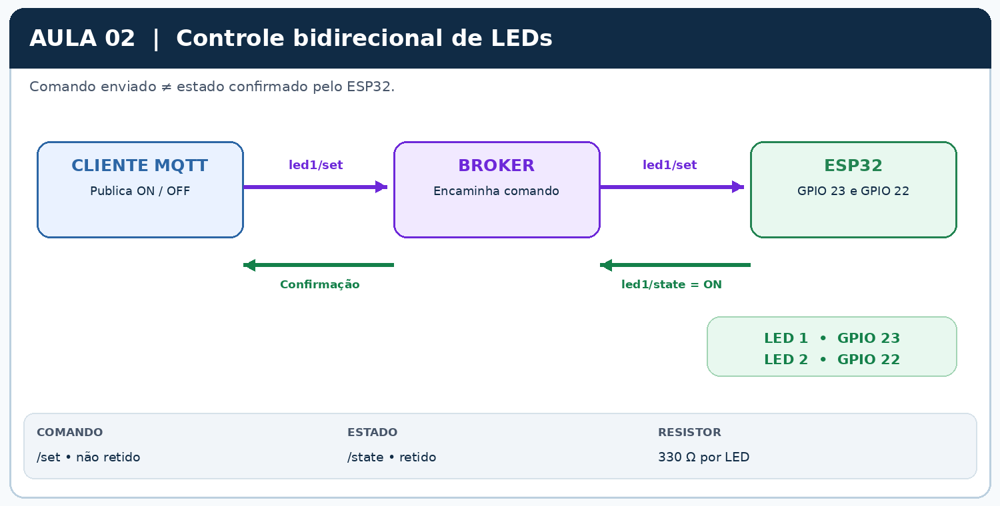

# Aula 02 — Controle remoto de dois LEDs

**Duração:** 100 minutos.  
**Objetivos:** Montar LEDs com resistores e comandá-los por tópicos; Publicar estados confirmados e compreender retained.

## Roteiro

1. **0–15 min:** revisão, problema motivador e objetivos.
2. **15–30 min:** leitura do diagrama e conceitos necessários.
3. **30–60 min:** montagem e programação guiada.
4. **60–80 min:** integração, depuração e teste.
5. **80–90 min:** exercício de extensão.
6. **90–100 min:** registro de evidências e avaliação.

## Fontes desta etapa

- [`esp32_leds.ino`](codigo/esp32_leds.ino)

## Verificação

- [ ] Explicar o fluxo da mensagem MQTT.
- [ ] Executar a etapa no hardware ou em demonstração orientada.
- [ ] Registrar a saída do monitor serial ou navegador.
- [ ] Responder às questões da apostila do aluno.

**Material completo:** [apostila do estudante](../../materiais/apostilas/aluno/apostila-aluno.pdf).  
**Professor:** [manual](../../materiais/apostilas/professor/manual-professor.pdf).
